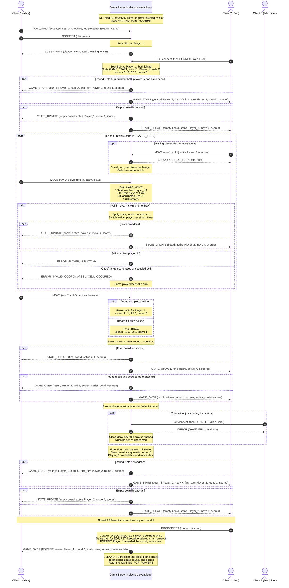

# Server Concurrency Architecture and Game Synchronization Design

**Project:** cs457-tictactoe
**Author:** Jake VanAllen
**Sprint:** 2 (Game Behavior and Server Concurrency Architecture)
**Companion documents:** [`protocol_blueprint.md`](protocol_blueprint.md), [`fsm_specification.md`](fsm_specification.md)

This document defines how the Tic-Tac-Toe server handles several client connections at once without blocking, how the game state is kept consistent while those connections are serviced, and how moves, turns, and scores are pushed to both players. Message formats, error codes, and state names are defined in the companion documents and are referenced here, not redefined.

---

## 1. Concurrency Model Selection

**Chosen model: non-blocking I/O multiplexing with Python's `selectors` module (Option B).**

The server runs one thread containing one event loop. Every socket, including the listening socket, is set to non-blocking mode and registered with a `selectors.DefaultSelector`, which uses `epoll` on Linux. The loop blocks only inside `sel.select()`, waiting until at least one socket is ready to read or write or a timer is due. It then services each ready socket and returns to `select()`.

| Consideration | Threads with locks (Option A) | `selectors` event loop (Option B, chosen) |
|---|---|---|
| Shared game state | Every access needs a lock. A missed lock is a silent race condition. | Only one handler runs at a time, so no access can interleave with another. |
| Turn ordering | Two worker threads can receive simultaneous `MOVE` messages. Correctness depends on lock scope. | Events are delivered to the game logic strictly one after another. |
| Broadcast | A thread sending to both clients must hold the lock or risk sending a mix of two states. | A broadcast is queued for both clients within a single handler call, so it cannot be split. |
| Resource cost | One thread per client plus synchronization overhead. | One thread total, scales to many sockets. |
| Fit for this game | Tic-Tac-Toe does almost no computation per message, so threads gain nothing. | Work per event is tiny, which is the ideal case for an event loop. |

Python's Global Interpreter Lock means threads would not run game logic in parallel anyway. The game is I/O bound and turn based, so a single event loop gives the same responsiveness with far fewer ways to fail.

---

## 2. Server Architecture Overview

The server is split into three layers so that only one layer ever touches sockets.

| Layer | Module | Responsibility | Touches sockets? |
|---|---|---|---|
| Event loop | `server.py` | Owns the selector, accepts connections, reads and writes bytes, runs timers, closes sockets. | Yes, and it is the only layer that does. |
| Framing and validation | `protocol/framing.py`, `protocol/messages.py` | Splits the byte stream into newline-delimited frames, decodes JSON, validates the envelope and payload schema. | No |
| Game logic | `server/game_fsm.py` (`GameFSM`) | Implements the state machine in `fsm_specification.md`. Returns a list of `Outbound(conn_id, message, close_after)` items describing what to send. | No |

The event loop calls `GameFSM` and then performs whatever I/O the returned `Outbound` list asks for. Because `GameFSM` never performs I/O itself, it can never block, and it can be unit tested without a network.

### 2.1 Per-Connection Record

Each accepted socket is paired with one `Connection` object, stored as the `data` attribute of its selector key and in a registry keyed by `conn_id`.

| Field | Type | Purpose |
|---|---|---|
| `conn_id` | string | Unique ID assigned at accept time, such as `"c7"`. Used by `GameFSM` to address messages. |
| `sock` | socket | The non-blocking client socket. |
| `addr` | tuple | Client IP address and port, for logging. |
| `inbuf` | bytearray | Bytes received but not yet terminated by `\n`. |
| `outbuf` | bytearray | Encoded frames waiting to be written. |
| `player_id` | string or null | `"Player_1"` or `"Player_2"` once seated, otherwise null. |
| `close_after_flush` | boolean | When true, the server stops reading from this socket and closes it as soon as `outbuf` is empty. |
| `closed` | boolean | Set when the connection is torn down, so stale selector events for it are ignored. |

---

## 3. Connection Lifecycle

Every client connection passes through five phases: listen, accept, register, service, and teardown.

### 3.1 Listening Socket Setup (FSM state `INIT`)

```python
sel = selectors.DefaultSelector()

lsock = socket.socket(socket.AF_INET, socket.SOCK_STREAM)
lsock.setsockopt(socket.SOL_SOCKET, socket.SO_REUSEADDR, 1)
lsock.bind(("0.0.0.0", 5555))
lsock.listen(5)
lsock.setblocking(False)
sel.register(lsock, selectors.EVENT_READ, data=None)
```

`SO_REUSEADDR` lets the server restart immediately without waiting for old connections in `TIME_WAIT`. Binding to `0.0.0.0` accepts connections on every interface, which is required once the server runs on its own subnet in CML. The listening socket is registered with `data=None`, which is how the event loop tells it apart from client sockets. A failed `bind()` ends the process, matching FSM transition T2.

### 3.2 Accepting a Connection

When the listening socket becomes readable, a client is waiting in the accept queue.

```python
def accept_wrapper(lsock):
    sock, addr = lsock.accept()          # ready, so this does not block
    sock.setblocking(False)
    enable_keepalive(sock)               # section 3.6
    conn = Connection(conn_id=next_id(), sock=sock, addr=addr)
    registry[conn.conn_id] = conn
    sel.register(sock, selectors.EVENT_READ, data=conn)
```

New sockets are registered for `EVENT_READ` only. Write interest is added only when there is something to send (section 3.4). This avoids the busy loop that occurs when a socket is always registered for `EVENT_WRITE`, since a healthy socket is almost always writable and `select()` would return immediately on every pass.

### 3.3 Registering the Client in the Game

An accepted TCP connection is not yet a player. It becomes one only after it sends a valid `CONNECT`:

| Situation when `CONNECT` arrives | Server action |
|---|---|
| No seats filled | Seat as `Player_1`, send `LOBBY_WAIT` (FSM T3). |
| `Player_1` seated, lobby open | Seat as `Player_2`, start round 1 (FSM T7 and T8). |
| Both seats filled | Send fatal `ERROR` `GAME_FULL`, set `close_after_flush` (FSM T12). The running series is not affected. |
| Same connection already seated | Send `ERROR` `ALREADY_CONNECTED`. |

### 3.4 Servicing an Active Connection

The read path turns bytes into game events. The write path drains the outbound buffer.

```python
def service_connection(key, mask):
    conn = key.data
    if conn.closed:
        return                                   # stale event, see section 4.3
    if mask & selectors.EVENT_READ and not conn.close_after_flush:
        try:
            chunk = conn.sock.recv(4096)
        except BlockingIOError:
            chunk = None                         # spurious wakeup, nothing to read
        except (ConnectionResetError, ConnectionAbortedError, TimeoutError):
            return client_disconnected(conn)
        if chunk == b"":
            return client_disconnected(conn)     # EOF, peer closed cleanly
        if chunk:
            conn.inbuf += chunk
            for frame in extract_frames(conn):   # split on b"\n"
                dispatch(conn, frame)            # validate, call GameFSM, queue output
    if mask & selectors.EVENT_WRITE:
        flush(conn)
```

`extract_frames()` removes each complete `\n`-terminated frame from `inbuf` and leaves any partial frame in place for the next `recv()`. If `inbuf` grows past 4096 bytes without a newline, the server sends fatal `ERROR` `MESSAGE_TOO_LARGE` and treats the client as disconnected.

`dispatch()` validates the frame and calls the matching `GameFSM` handler, which returns a list of `Outbound` items. Each item is passed to `enqueue()`:

```python
def enqueue(conn, message, close_after=False):
    conn.outbuf += encode_message(message)      # compact JSON + b"\n"
    if close_after:
        conn.close_after_flush = True
    sel.modify(conn.sock, selectors.EVENT_READ | selectors.EVENT_WRITE, data=conn)

def flush(conn):
    try:
        sent = conn.sock.send(conn.outbuf)       # may send only part of the buffer
    except BlockingIOError:
        return                                   # kernel buffer full, try next pass
    except (BrokenPipeError, ConnectionResetError, ConnectionAbortedError):
        return client_disconnected(conn)
    del conn.outbuf[:sent]
    if not conn.outbuf:
        if conn.close_after_flush:
            return close_connection(conn)
        sel.modify(conn.sock, selectors.EVENT_READ, data=conn)
```

The server never calls `sendall()`. On a non-blocking socket, `sendall()` can raise `BlockingIOError` after sending only part of a frame, which would corrupt the stream. Instead, `send()` is called whenever the socket is writable, and whatever it does not accept stays in `outbuf` for the next pass.

### 3.5 The Event Loop and Timers

```python
while True:
    events = sel.select(timeout=next_timer_delay())   # None if no timer is pending
    for key, mask in events:
        if key.data is None:
            accept_wrapper(key.fileobj)
        else:
            service_connection(key, mask)
    for out in fsm.handle_tick(time.monotonic()):     # intermission and turn timers
        enqueue(registry[out.conn_id], out.message, out.close_after)
```

The game uses two timers, both kept as deadlines in the game context rather than as threads:

| Timer | Deadline field | Fires when | Effect |
|---|---|---|---|
| Intermission | `next_round_at` | 3 seconds after a round ends with both players still seated | Next round starts (FSM T21). |
| Turn limit | `turn_deadline` | The active player has not sent a valid `MOVE` within 120 seconds | Treated as a disconnect of the active player, so the opponent wins by forfeit (FSM T13). |

`next_timer_delay()` returns the time until the earliest pending deadline, so `select()` wakes up exactly when a timer is due and the loop never polls.

### 3.6 Teardown

Every way a connection can end leads to one of two functions.

```python
def client_disconnected(conn):
    for out in fsm.handle_disconnect(conn.conn_id):   # may send GAME_OVER to the opponent
        enqueue(registry[out.conn_id], out.message, out.close_after)
    close_connection(conn)

def close_connection(conn):
    if conn.closed:
        return
    conn.closed = True
    sel.unregister(conn.sock)       # always before close()
    conn.sock.close()
    del registry[conn.conn_id]
```

| How the connection ends | Detected by | Handling |
|---|---|---|
| Client sends `DISCONNECT` | `dispatch()` | `client_disconnected()` immediately. |
| Client closes without `DISCONNECT` (FIN) | `recv()` returns `b""` | `client_disconnected()`. |
| Client crashes or resets (RST) | `ConnectionResetError` or `ConnectionAbortedError` | `client_disconnected()`. |
| Server writes to a closed peer | `BrokenPipeError` in `flush()` | `client_disconnected()`. |
| Silent link failure, such as a cut CML link | TCP keepalive gives up and `recv()` raises `TimeoutError` | `client_disconnected()`. |
| Active player stops responding | Turn timer expires | Forfeit to opponent, then teardown. |
| Server ends the connection on purpose (`GAME_FULL`, `MESSAGE_TOO_LARGE`, series over) | `close_after_flush` | `close_connection()` once the final message is written. |

Silent link failures are detected with TCP keepalive instead of an application idle timeout. An idle timeout would wrongly disconnect the waiting player, who legitimately sends nothing while the opponent thinks. Keepalive probes the peer at the TCP layer without involving the application:

```python
def enable_keepalive(sock):
    sock.setsockopt(socket.SOL_SOCKET, socket.SO_KEEPALIVE, 1)
    sock.setsockopt(socket.IPPROTO_TCP, socket.TCP_KEEPIDLE, 30)   # first probe after 30 s idle
    sock.setsockopt(socket.IPPROTO_TCP, socket.TCP_KEEPINTVL, 10)  # then every 10 s
    sock.setsockopt(socket.IPPROTO_TCP, socket.TCP_KEEPCNT, 3)     # give up after 3 misses
```

A dead peer is therefore detected within about 60 seconds.

### 3.7 Multi-Client Capacity

| Limit | Value | Reason |
|---|---|---|
| Simultaneous TCP connections | Not limited by the design. `epoll` handles thousands of sockets. | One selector services every socket in one loop. |
| Seated players | 2 | Tic-Tac-Toe is a two-player game. Additional joiners receive `GAME_FULL`. |
| Listen backlog | 5 | Enough for a burst of joiners. Excess connections wait in the kernel queue. |
| Inbound buffer per connection | 4096 bytes without a newline | Prevents one client from exhausting memory (`MESSAGE_TOO_LARGE`). |
| Outbound buffer per connection | 64 KB | A client that stops reading is treated as disconnected rather than allowed to grow server memory without bound. |

While both players are seated, a third client can still connect and is answered and closed without delaying the game, because accepting and rejecting it are two short events in the same loop.

---

## 4. State Isolation and Thread Safety

### 4.1 Shared Resources

These are the resources that more than one client's events can read or change. Under a threaded design, each would need a lock.

| Resource | Location | Changed by | What a race could break under threads |
|---|---|---|---|
| `board` | `GameFSM` context | `MOVE` accepted, round reset | Two moves applied to one board state, or a move landing during a reset. |
| `active_player` | `GameFSM` context | `MOVE` accepted, round start | Both players passing the turn check at the same time. |
| `move_number` | `GameFSM` context | `MOVE` accepted | A lost increment, causing a wrong draw decision. |
| `state` | `GameFSM` context | Every transition | A move evaluated while the game is ending. |
| `seats` and `aliases` | `GameFSM` context | `CONNECT`, disconnect, cleanup | Two clients seated as the same player, or a third player seated. |
| `scores`, `round`, `marks` | `GameFSM` context | Round end, forfeit, cleanup | A lost or doubled point, or marks swapped twice. |
| `next_round_at`, `turn_deadline` | `GameFSM` context | Round end, turn change | A round starting twice or a turn timing out after a valid move. |
| `registry` (connections) | Event loop | Accept, teardown | Sending to a socket that another thread just closed. |
| `inbuf` and `outbuf` | Each `Connection` | Read and write of that connection | Two frames interleaved byte by byte on the wire. |

### 4.2 Why No Locks Are Needed

All of the resources above are accessed only from the event loop thread. The design relies on three properties:

1. **One thread.** No other thread exists, so no code can be interrupted partway through by other server code.
2. **Run to completion.** Each handler (`accept_wrapper`, `service_connection`, `handle_tick`) runs from start to finish before the loop picks up the next event. A `select()` call never happens inside a handler.
3. **Serial event delivery.** Events reach `GameFSM` one at a time, which is the requirement stated in section 8 of the FSM specification.

The result is that each handler call acts as its own critical section. The table below lists the operations that must never be observed half finished, which are the places a threaded design would hold `threading.Lock`:

| Atomic unit | Steps that run together in one handler call |
|---|---|
| Move processing | Validate turn and cell, apply mark, increment `move_number`, check win then draw, update `scores`, switch `active_player`, reset `turn_deadline`, queue `STATE_UPDATE` (and `GAME_OVER`) for both players. |
| Seating | Check free seats, assign `Player_1` or `Player_2`, record alias, queue `LOBBY_WAIT` or round start messages. |
| Round reset | Clear `board`, swap `marks`, increment `round`, set `active_player` to the player holding `X`, queue `GAME_START` and `STATE_UPDATE` for both players. |
| Disconnect | Record forfeit, award the round if it was in progress, queue `GAME_OVER` to the remaining player, release the seat, close the socket. |
| Cleanup | Close remaining client sockets and reset every context field, including `scores`, to initial values. |

### 4.3 Hazards That Still Apply to an Event Loop, and How They Are Handled

A single thread removes data races, but it introduces its own failure modes.

| Hazard | Risk | Mitigation |
|---|---|---|
| A blocking call inside a handler | One slow call stalls every client. | All client sockets are non-blocking. No `sendall()`, `sleep()`, or blocking `recv()` anywhere in the loop. Timers use deadlines checked after `select()`. |
| Two moves in one `select()` batch | Both players' `MOVE` frames are returned by the same `select()` call. | They are dispatched one after the other. The first valid move switches `active_player`, so the second is rejected with `OUT_OF_TURN` against the updated state. |
| Several frames in one `recv()` | A client sends two `MOVE` frames that arrive together. | `extract_frames()` yields them in order, and each is evaluated against the state left by the one before it. |
| Stale events | Handling one socket closes another socket that also appears later in the same event list. | `close_connection()` sets `conn.closed`, and `service_connection()` returns immediately for a closed connection. |
| Partial writes | `send()` accepts only part of a frame. | Unsent bytes stay at the front of `outbuf`, so frames are never reordered or interleaved. |
| An unexpected exception | A bug in one client's handling would stop the whole server. | Each `service_connection()` call is wrapped so that an unexpected exception is logged, that client is disconnected, and the loop continues. |

---

## 5. Turn Enforcement

The server is the only component that decides whose turn it is. A client's opinion is never trusted. Every `MOVE` passes these checks in order, and the first failure produces an `ERROR` to the sender only:

| Order | Check | Failure code |
|---|---|---|
| 1 | The game is in `PLAYER_TURN`. A move during the lobby or the intermission between rounds is rejected. | `NOT_IN_GAME` |
| 2 | `player_id` matches the seat bound to this connection. A client cannot claim to be the other player. | `PLAYER_MISMATCH` |
| 3 | `player_id` equals `active_player`. | `OUT_OF_TURN` |
| 4 | `row` and `col` are integers from 0 to 2. | `INVALID_COORDINATES` |
| 5 | The target cell is empty. | `CELL_OCCUPIED` |

A rejected move changes nothing: not the board, not `active_player`, not `move_number`, and not the turn timer. Only the sender is told, so the opponent's screen is undisturbed. Because moves are processed serially (section 4.2), there is no window in which an out-of-turn move could slip past check 3.

---

## 6. Score and Round Synchronization

### 6.1 Series Play

Players stay connected after a round ends. Three seconds later the server starts the next round automatically, swapping marks so that each player alternates between `X` and `O`. Since `X` always moves first, the first move alternates between the players. The series continues until a player leaves. The full message changes are in `protocol_blueprint.md` sections 3.4, 3.6, and 3.9.

### 6.2 Score Storage

Scores live in the `GameFSM` context, in server memory, for the life of the series.

| Field | Type | Initial value | Meaning |
|---|---|---|---|
| `round` | integer | 1 | Number of the current or most recent round. |
| `scores` | object | `{"Player_1":0,"Player_2":0,"draws":0}` | Rounds won by each player, plus drawn rounds. |
| `marks` | object | `{"Player_1":"X","Player_2":"O"}` | Mark held by each player in the current round. Swapped at each round reset. |

| Round outcome | Score change |
|---|---|
| A player completes a line (`WIN`) | Winner's count increases by 1. |
| Board fills with no line (`DRAW`) | `draws` increases by 1. |
| A player leaves during a round (`FORFEIT`) | Remaining player's count increases by 1. The series ends. |
| A player leaves during the intermission | No change, since the last round was already scored. The series ends. |

Scores are reset only in `CLEANUP`, when the series is over and both seats are released.

### 6.3 Score Broadcast Logic

The scoreboard is never sent as a separate message. It travels inside the messages that already go to both players, so a client always shows the score that matches the board it is displaying.

| Message | When | Score content |
|---|---|---|
| `GAME_START` | Start of every round | `round` and current `scores`, so a new round opens with the right totals. |
| `STATE_UPDATE` | After every accepted move and at round start | `round` and current `scores`. |
| `GAME_OVER` | End of every round | `round`, updated `scores`, and `series_continues`. |

When a round ends, the server performs these steps inside the single handler call that accepted the deciding move:

1. Update `scores` according to the table in section 6.2.
2. Queue the final `STATE_UPDATE` (board with `active_player` null) for both players.
3. Queue `GAME_OVER` with the updated `scores` and `series_continues: true` for both players.
4. Set `next_round_at` to 3 seconds from now.

When the intermission timer fires and both players are still connected, the server resets the board, swaps marks, increments `round`, and queues a fresh `GAME_START` and `STATE_UPDATE` for both players. If a player has left, the remaining player instead receives `GAME_OVER` with `series_continues: false` and the final totals, and the server closes that connection.

---

## 7. Broadcast Mechanism and Synchronization Guarantee

Any message that both players must see goes through one function:

```python
def broadcast(message):
    frame = encode_message(message)           # encoded once
    for conn in seated_connections():
        conn.outbuf += frame                  # identical bytes to every player
        sel.modify(conn.sock, selectors.EVENT_READ | selectors.EVENT_WRITE, data=conn)
```

This gives the following guarantees:

1. **Identical content.** The message is encoded once, timestamp included, so both players receive byte-for-byte the same frame.
2. **Atomic delivery decision.** The frame is queued for both players in the same handler call, before the loop handles any other event. No move can be processed between the copy queued for one player and the copy queued for the other.
3. **Same order for everyone.** Each `outbuf` is a first-in, first-out queue, and TCP preserves byte order, so both players receive every state change in the same sequence. A client can never see move 5 before move 4. The `move_number` and `round` fields let a client confirm it is up to date.
4. **Independent delivery.** If one player's connection fails while its copy is being written, only that connection enters the disconnect path. The other player's queued copy is unaffected.

"Synchronous" here means both players are given the same state at the same logical point in the game. The two frames leave the server microseconds apart rather than at the exact same instant, which is unavoidable with two separate TCP connections. This does not affect correctness, because every decision is made against the server's authoritative state, never the client's copy.

---

## 8. Sequence Diagram: Turns, Scores, and Broadcasts

The diagram covers every message type in the protocol: `CONNECT`, `LOBBY_WAIT`, `GAME_START`, `MOVE`, `STATE_UPDATE`, `ERROR`, `DISCONNECT`, and `GAME_OVER`. Each `par` block marks a broadcast that is queued for both players in one handler call.



### 8.1 Narrative

The numbers below refer to the message numbers shown on the rendered diagram.

**Joining (messages 1 to 4).** Alice's TCP connection is accepted and registered with the selector. Her `CONNECT` seats her as `Player_1`, and `LOBBY_WAIT` tells her the server is waiting for an opponent. Bob connects and sends `CONNECT`, filling the second seat.

**Round start (messages 5 to 8).** In the same handler call that seated Bob, the server sends each player a personalized `GAME_START` with their ID, mark, the round number, and the starting scores, then broadcasts the empty board. Both broadcasts are queued for both players before the loop handles anything else.

**Turn loop (messages 9 to 15).** If Bob tries to move while it is Alice's turn, only Bob receives `ERROR` `OUT_OF_TURN`, and nothing about the game changes. When Alice moves, the server runs the checks in section 5. A valid move is applied, the turn passes to Bob, and the new board is broadcast to both players. A move with the wrong `player_id`, bad coordinates, or an occupied cell returns an `ERROR` to Alice only, and she keeps the turn.

**Round end (messages 16 to 20).** The deciding move produces either a `WIN` or a `DRAW`, and `scores` is updated before anything is sent. Both players then receive the final board and a `GAME_OVER` containing the updated scoreboard and `series_continues: true`. The server sets the 3-second intermission timer.

**Late joiner (messages 21 and 22).** A third client that connects during the series receives a fatal `GAME_FULL` error and is closed once that error is written. The series continues untouched.

**Next round (messages 23 to 26).** When the timer fires, the server clears the board, swaps marks, and starts round 2 with a fresh `GAME_START` and empty-board `STATE_UPDATE` for both players. Bob now holds `X` and moves first.

**Leaving (messages 27 and 28).** Bob sends `DISCONNECT`. A crash, a cut link, or a turn timeout would follow the same path. Alice is awarded the round by forfeit and receives a final `GAME_OVER` with the series totals and `series_continues: false`. The server closes both connections, resets the game context including scores, and returns to waiting for new players.

---

## 9. Changes to Sprint 1 Documents

Series play and the event loop required these updates to the Sprint 1 specifications, made in the same commit as this document:

| Document | Change |
|---|---|
| `protocol_blueprint.md` | Added `round` and `scores` to `GAME_START` and `STATE_UPDATE`. Added `round`, `scores`, and `series_continues` to `GAME_OVER`. Marks now alternate each round. Connections stay open between rounds. Replaced the 120-second idle timeout with a turn timer and TCP keepalive. Server writes use buffered `send()` instead of `sendall()`. |
| `fsm_specification.md` | `GAME_OVER` now holds during the intermission. Added transitions T20 through T23 for the intermission, the next round, and the end of the series. Added `round`, `scores`, `marks`, `next_round_at`, and `turn_deadline` to the game context. `CLEANUP` resets scores. |
| `ai_prompts.md` | Updated framing and exception rules for non-blocking sockets, and added `handle_tick()` to the `GameFSM` interface. |
