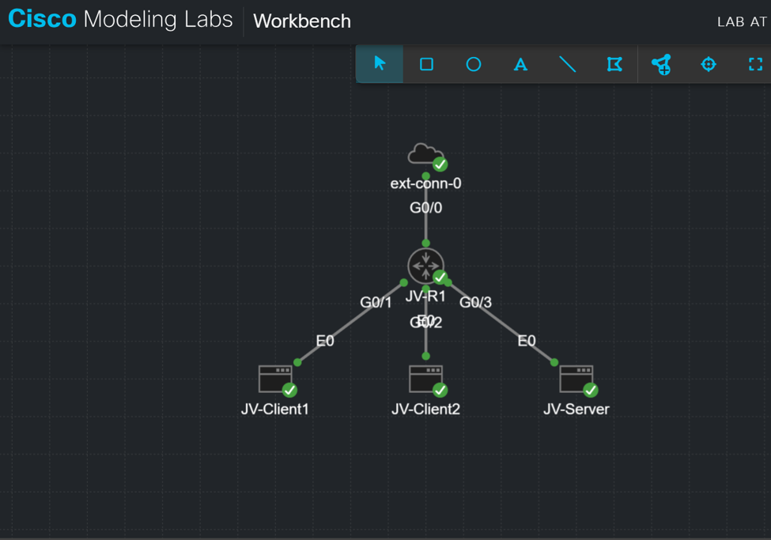
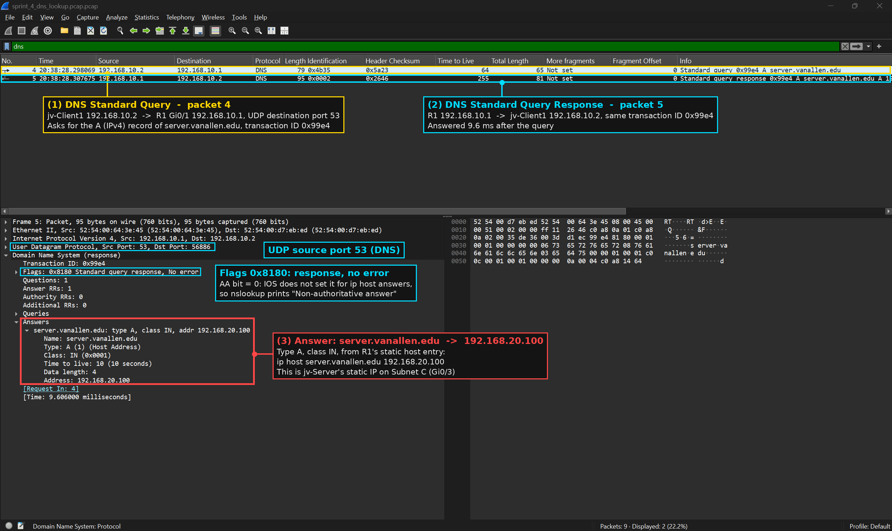

# Sprint 4 Network Verification Report

| | |
|---|---|
| **Project** | CS 457 Two-Player Networked Tic-Tac-Toe |
| **Student** | Jake VanAllen |
| **Repository** | https://github.com/jwvan22/cs457-tictactoe |
| **Lab environment** | Cisco Modeling Labs, one Cisco IOSv router and three Alpine Linux nodes |
| **Game server FQDN** | `server.vanallen.edu` → `192.168.20.100` |

## Contents

1. Topology
2. Addressing plan
3. Router R1 configuration
4. Router verification (`show ip interface brief`, `show ip route`, `show ip dhcp binding`, `show hosts`)
5. Game server static addressing
6. Client DHCP leases
7. Cross-subnet connectivity (`ping`)
8. DNS resolution (`nslookup`)
9. Wireshark DNS capture (`sprint_4_dns_lookup.pcap`)
10. Acceptance criteria summary

## 1. Topology



A single router, JV-R1, connects three directly attached subnets on Gi0/1, Gi0/2, and Gi0/3. Gi0/0 connects to a CML External Connector in NAT mode so the nodes can reach package repositories and GitHub. The node names use the initials JV as required, and the exported topology is `sprint_4_topology.yaml`.

## 2. Addressing plan

| Node | Interface | Subnet | Address | Assigned by |
|---|---|---|---|---|
| JV-R1 | Gi0/0 | 192.168.255.0/24 (External Connector) | 192.168.255.239 | DHCP from External Connector |
| JV-R1 | Gi0/1 | Subnet A, 192.168.10.0/24 | 192.168.10.1 | Static (gateway) |
| JV-R1 | Gi0/2 | Subnet B, 192.168.11.0/24 | 192.168.11.1 | Static (gateway) |
| JV-R1 | Gi0/3 | Subnet C, 192.168.20.0/24 | 192.168.20.1 | Static (gateway) |
| JV-Client1 | eth0 | Subnet A | 192.168.10.2 | DHCP, `CLIENT1_POOL` |
| JV-Client2 | eth0 | Subnet B | 192.168.11.2 | DHCP, `CLIENT2_POOL` |
| JV-Server | eth0 | Subnet C | 192.168.20.100 | Static |

## 3. Router R1 configuration

This is the configuration applied to JV-R1 and saved with `write memory`. It is also embedded in `sprint_4_topology.yaml`.

```
hostname R1
ip routing
!
interface GigabitEthernet0/0
 description Uplink to External Connector (NAT outside)
 ip address dhcp
 ip nat outside
 no shutdown
interface GigabitEthernet0/1
 description Subnet A gateway - jv-Client1
 ip address 192.168.10.1 255.255.255.0
 ip nat inside
 no shutdown
interface GigabitEthernet0/2
 description Subnet B gateway - jv-Client2
 ip address 192.168.11.1 255.255.255.0
 ip nat inside
 no shutdown
interface GigabitEthernet0/3
 description Subnet C gateway - jv-Server
 ip address 192.168.20.1 255.255.255.0
 ip nat inside
 no shutdown
!
ip dhcp excluded-address 192.168.10.1
ip dhcp excluded-address 192.168.11.1
ip dhcp pool CLIENT1_POOL
 network 192.168.10.0 255.255.255.0
 default-router 192.168.10.1
 dns-server 192.168.10.1
ip dhcp pool CLIENT2_POOL
 network 192.168.11.0 255.255.255.0
 default-router 192.168.11.1
 dns-server 192.168.11.1
!
ip domain lookup
ip dns server
ip host server.vanallen.edu 192.168.20.100
!
access-list 1 permit 192.168.10.0 0.0.0.255
access-list 1 permit 192.168.11.0 0.0.0.255
access-list 1 permit 192.168.20.0 0.0.0.255
ip nat inside source list 1 interface GigabitEthernet0/0 overload
```

## 4. Router verification

### 4.1 Interface status

All four routed interfaces are up/up. Gi0/1 through Gi0/3 carry the three gateway addresses, and Gi0/0 holds an address leased from the External Connector. NVI0 is the NAT virtual interface that IOS creates automatically once `ip nat inside` and `ip nat outside` are configured.

```
R1>show ip interface brief
Interface                  IP-Address      OK? Method Status                Protocol
GigabitEthernet0/0         192.168.255.239 YES DHCP   up                    up
GigabitEthernet0/1         192.168.10.1    YES manual up                    up
GigabitEthernet0/2         192.168.11.1    YES manual up                    up
GigabitEthernet0/3         192.168.20.1    YES manual up                    up
NVI0                       unassigned      YES unset  up                    up
```

### 4.2 Routing table

The three LAN subnets appear as Connected (`C`) routes, so R1 routes between them with no static routes. The `S*` default route was learned through DHCP on Gi0/0 and is used only for traffic leaving the lab through NAT.

```
R1>show ip route
Codes: L - local, C - connected, S - static, R - RIP, M - mobile, B - BGP
       D - EIGRP, EX - EIGRP external, O - OSPF, IA - OSPF inter area
       N1 - OSPF NSSA external type 1, N2 - OSPF NSSA external type 2
       E1 - OSPF external type 1, E2 - OSPF external type 2
       i - IS-IS, su - IS-IS summary, L1 - IS-IS level-1, L2 - IS-IS level-2
       ia - IS-IS inter area, * - candidate default, U - per-user static route
       o - ODR, P - periodic downloaded static route, H - NHRP, l - LISP
       a - application route
       + - replicated route, % - next hop override, p - overrides from PfR

Gateway of last resort is 192.168.255.1 to network 0.0.0.0

S*    0.0.0.0/0 [254/0] via 192.168.255.1
      192.168.10.0/24 is variably subnetted, 2 subnets, 2 masks
C        192.168.10.0/24 is directly connected, GigabitEthernet0/1
L        192.168.10.1/32 is directly connected, GigabitEthernet0/1
      192.168.11.0/24 is variably subnetted, 2 subnets, 2 masks
C        192.168.11.0/24 is directly connected, GigabitEthernet0/2
L        192.168.11.1/32 is directly connected, GigabitEthernet0/2
      192.168.20.0/24 is variably subnetted, 2 subnets, 2 masks
C        192.168.20.0/24 is directly connected, GigabitEthernet0/3
L        192.168.20.1/32 is directly connected, GigabitEthernet0/3
```

### 4.3 DHCP bindings

Each pool has issued one automatic lease on its own subnet. The hardware addresses (client ID prefix `01` followed by the MAC) match the `eth0` MAC addresses shown on the clients in Section 6: `52:54:00:d7:eb:ed` for JV-Client1 and `52:54:00:7e:af:01` for JV-Client2. The gateway `.1` addresses were excluded, so the first leases are `.2`.

```
R1>show ip dhcp binding
Bindings from all pools not associated with VRF:
IP address          Client-ID/              Lease expiration        Type
                    Hardware address/
                    User name
192.168.10.2        0152.5400.d7eb.ed       Nov 25 2026 03:26 AM    Automatic
192.168.11.2        0152.5400.7eaf.01       Nov 25 2026 03:27 AM    Automatic
```

### 4.4 DNS host table

The static A record for the game server is present and permanent.

```
R1>show hosts
Default domain is not set
Name/address lookup uses domain service
Name servers are 192.168.255.1

Codes: UN - unknown, EX - expired, OK - OK, ?? - revalidate
       temp - temporary, perm - permanent
       NA - Not Applicable None - Not defined

Host                      Port  Flags      Age Type   Address(es)
server.vanallen.edu       None  (perm, OK)  0   IP    192.168.20.100
```

The name server `192.168.255.1` was learned from the External Connector through `ip address dhcp` on Gi0/0. R1 answers `server.vanallen.edu` from its own host table and forwards other names, such as GitHub and the Alpine package mirrors, to that upstream resolver.

## 5. Game server static addressing

JV-Server was configured with the commands from assignment section 2.2: a static address of `192.168.20.100/24` on eth0, a default route via `192.168.20.1`, and `nameserver 192.168.20.1`. The console prompts below show the node's default Alpine hostname.

```
inserthostname-here:~$ ip addr show eth0
2: eth0: <BROADCAST,MULTICAST,UP,LOWER_UP> mtu 1500 qdisc pfifo_fast state UP qlen 1000
    link/ether 52:54:00:39:40:b0 brd ff:ff:ff:ff:ff:ff
    inet 192.168.20.100/24 scope global eth0
       valid_lft forever preferred_lft forever
    inet6 fe80::5054:ff:fe39:40b0/64 scope link
       valid_lft forever preferred_lft forever
inserthostname-here:~$ ip route
default via 192.168.20.1 dev eth0
192.168.20.0/24 dev eth0 scope link  src 192.168.20.100
inserthostname-here:~$ cat /etc/resolv.conf
nameserver 192.168.20.1
inserthostname-here:~$ ping -4 -c 4 192.168.20.1
PING 192.168.20.1 (192.168.20.1): 56 data bytes
64 bytes from 192.168.20.1: seq=0 ttl=42 time=7.668 ms
64 bytes from 192.168.20.1: seq=1 ttl=42 time=4.321 ms
64 bytes from 192.168.20.1: seq=2 ttl=42 time=2.871 ms
64 bytes from 192.168.20.1: seq=3 ttl=42 time=2.803 ms

--- 192.168.20.1 ping statistics ---
4 packets transmitted, 4 packets received, 0% packet loss
round-trip min/avg/max = 2.803/4.415/7.668 ms
```

The default route via `192.168.20.1` is what lets the server reply to clients on 192.168.10.0/24 and 192.168.11.0/24.

## 6. Client DHCP leases

Both clients ran `udhcpc -i eth0`. Each received an address, a default gateway (DHCP option 3), and a DNS server (DHCP option 6) from the pool matching the router interface the request arrived on.

### JV-Client1 (Subnet A)

```
inserthostname-here:~$ sudo udhcpc -i eth0
udhcpc: started, v1.37.0
udhcpc: broadcasting discover
udhcpc: broadcasting select for 192.168.10.2, server 192.168.10.1
udhcpc: lease of 192.168.10.2 obtained from 192.168.10.1, lease time 86400
inserthostname-here:~$ ip addr show eth0
2: eth0: <BROADCAST,MULTICAST,UP,LOWER_UP> mtu 1500 qdisc pfifo_fast state UP qlen 1000
    link/ether 52:54:00:d7:eb:ed brd ff:ff:ff:ff:ff:ff
    inet 192.168.10.2/24 scope global eth0
       valid_lft forever preferred_lft forever
    inet6 fe80::5054:ff:fed7:ebed/64 scope link
       valid_lft forever preferred_lft forever
inserthostname-here:~$ ip route
default via 192.168.10.1 dev eth0  metric 202
192.168.10.0/24 dev eth0 scope link  src 192.168.10.2
inserthostname-here:~$ cat /etc/resolv.conf
nameserver 192.168.10.1
```

### JV-Client2 (Subnet B)

```
inserthostname-here:~$ sudo udhcpc -i eth0
udhcpc: started, v1.37.0
udhcpc: broadcasting discover
udhcpc: broadcasting select for 192.168.11.2, server 192.168.11.1
udhcpc: lease of 192.168.11.2 obtained from 192.168.11.1, lease time 86400
inserthostname-here:~$ ip addr show eth0
2: eth0: <BROADCAST,MULTICAST,UP,LOWER_UP> mtu 1500 qdisc pfifo_fast state UP qlen 1000
    link/ether 52:54:00:7e:af:01 brd ff:ff:ff:ff:ff:ff
    inet 192.168.11.2/24 scope global eth0
       valid_lft forever preferred_lft forever
    inet6 fe80::5054:ff:fe7e:af01/64 scope link
       valid_lft forever preferred_lft forever
inserthostname-here:~$ ip route
default via 192.168.11.1 dev eth0  metric 202
192.168.11.0/24 dev eth0 scope link  src 192.168.11.2
inserthostname-here:~$ cat /etc/resolv.conf
nameserver 192.168.11.1
```

## 7. Cross-subnet connectivity

Both clients reached the game server on Subnet C through R1 with zero packet loss.

### JV-Client1 → JV-Server

```
inserthostname-here:~$ ping -4 -c 4 192.168.20.100
PING 192.168.20.100 (192.168.20.100): 56 data bytes
64 bytes from 192.168.20.100: seq=0 ttl=42 time=5.893 ms
64 bytes from 192.168.20.100: seq=1 ttl=42 time=1.773 ms
64 bytes from 192.168.20.100: seq=2 ttl=42 time=3.031 ms
64 bytes from 192.168.20.100: seq=3 ttl=42 time=3.218 ms

--- 192.168.20.100 ping statistics ---
4 packets transmitted, 4 packets received, 0% packet loss
round-trip min/avg/max = 1.773/3.478/5.893 ms
```

### JV-Client2 → JV-Server

```
inserthostname-here:~$ ping -4 -c 4 192.168.20.100
PING 192.168.20.100 (192.168.20.100): 56 data bytes
64 bytes from 192.168.20.100: seq=0 ttl=42 time=4.498 ms
64 bytes from 192.168.20.100: seq=1 ttl=42 time=3.140 ms
64 bytes from 192.168.20.100: seq=2 ttl=42 time=2.939 ms
64 bytes from 192.168.20.100: seq=3 ttl=42 time=2.978 ms

--- 192.168.20.100 ping statistics ---
4 packets transmitted, 4 packets received, 0% packet loss
round-trip min/avg/max = 2.939/3.388/4.498 ms
```

## 8. DNS resolution

Each client queried R1 through its own gateway address, which DHCP had set as its resolver, and received `192.168.20.100` for `server.vanallen.edu`. The `-type=A` option asks only for the IPv4 record, as the assignment directs for Alpine.

### JV-Client1

```
inserthostname-here:~$ nslookup -type=A server.vanallen.edu
Server:         192.168.10.1
Address:        192.168.10.1:53

Non-authoritative answer:
Name:   server.vanallen.edu
Address: 192.168.20.100
```

### JV-Client2

```
inserthostname-here:~$ nslookup -type=A server.vanallen.edu
Server:         192.168.11.1
Address:        192.168.11.1:53

Non-authoritative answer:
Name:   server.vanallen.edu
Address: 192.168.20.100
```

**About the "Non-authoritative answer" label.** R1 is the source of this record: the answer comes from its own `ip host` entry, and no other DNS server is involved. Cisco IOS answers host-table lookups without setting the DNS Authoritative Answer (AA) bit, and BusyBox `nslookup` prints "Non-authoritative" whenever that bit is 0. The capture in Section 9 confirms this. The response flags are `0x8180`, meaning a response with recursion desired and available and no error, with the AA bit clear.

## 9. Wireshark DNS capture

The capture was taken with CML's built-in packet capture on the link between JV-Client1 and JV-R1 Gi0/1 while JV-Client1 ran `nslookup -type=A server.vanallen.edu`. The raw trace is committed as `sprint_4_dns_lookup.pcap`. The capture holds 9 packets in total, and the `dns` display filter isolates the two packets of the exchange.



| Packet | Direction | Transport | Content |
|---|---|---|---|
| 4 | JV-Client1 192.168.10.2 → R1 192.168.10.1 | UDP, destination port 53 | Standard query `0x99e4`, type A, `server.vanallen.edu` |
| 5 | R1 192.168.10.1 → JV-Client1 192.168.10.2 | UDP, source port 53, destination port 56886 | Standard query response `0x99e4`, flags `0x8180` (no error), 1 answer: `server.vanallen.edu` type A, class IN, TTL 10, address **192.168.20.100** |

The response matches the query's transaction ID and arrived 9.6 ms later. It carries exactly one answer record, and that record holds the game server's static address.

## 10. Acceptance criteria summary

| Criterion | Evidence | Result |
|---|---|---|
| Single router connects 192.168.10.0/24, 192.168.11.0/24, and 192.168.20.0/24 | Sections 1, 4.1, 4.2: three connected routes, all interfaces up/up | Met |
| Separate DHCP pools issue IP, gateway, and DNS to each client | Sections 3, 4.3, 6: `CLIENT1_POOL` and `CLIENT2_POOL`, gateways excluded, two active bindings | Met |
| Server has static 192.168.20.100/24 with default gateway 192.168.20.1 | Section 5 | Met |
| DNS resolves `server.vanallen.edu` to 192.168.20.100, shown in the pcap and report | Sections 4.4, 8, 9 | Met on both clients |
| Both clients ping the server across subnets with no loss | Section 7: 4/4 received, 0% loss from each client | Met |
| Deliverables committed with standard names | `sprint_4_topology.yaml`, `sprint_4_dns_lookup.pcap`, `sprint_4_network_report.md` and `.pdf` | Met |
